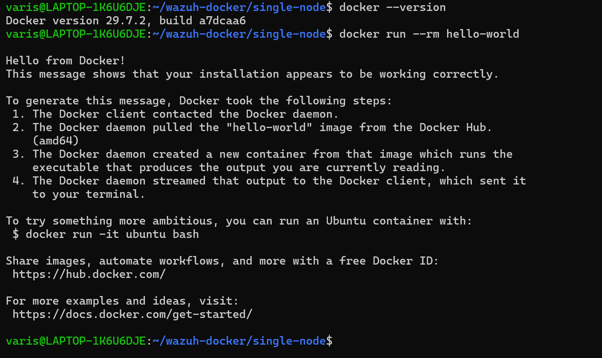
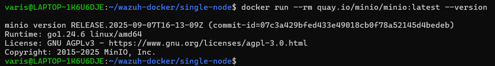
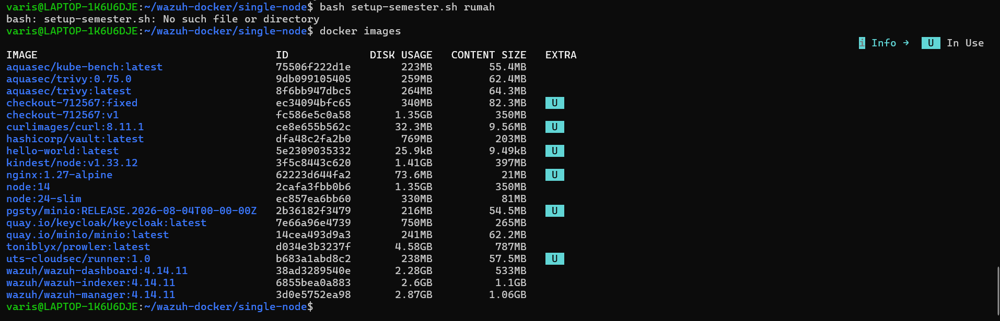
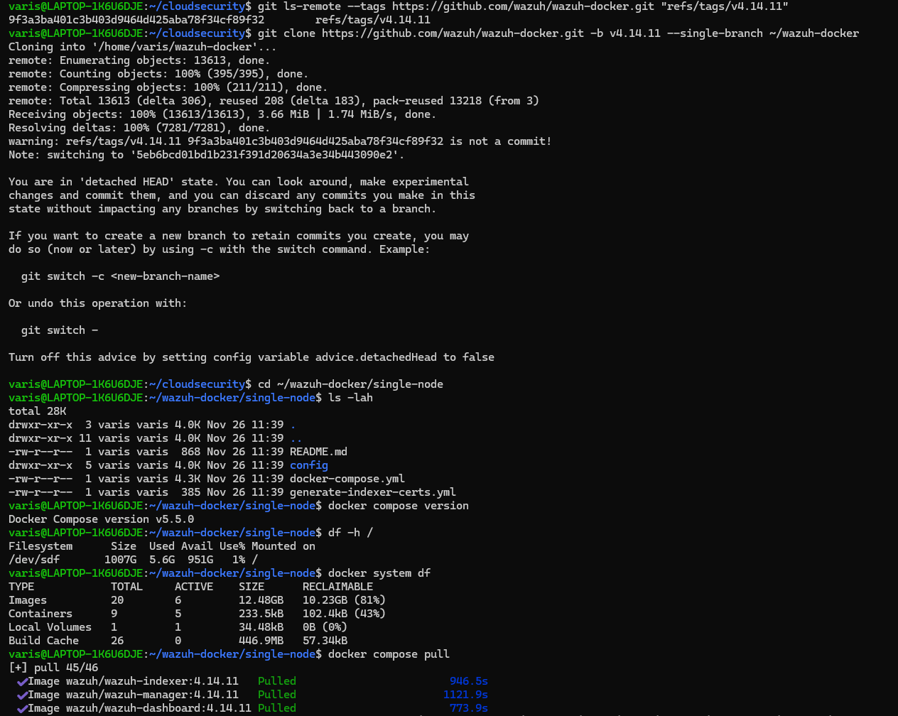
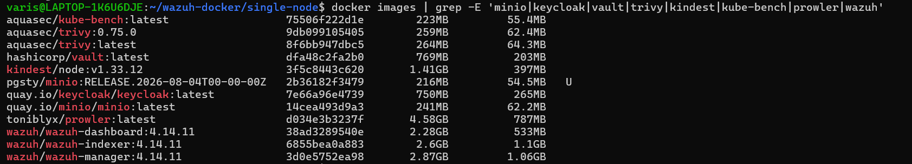

# Praktikum 1 — Shared Responsibility Model dan Environment Setup

## 1. Deskripsi Praktikum

Praktikum pertama mata kuliah Cloud Security membahas Shared Responsibility Model dan persiapan environment yang akan digunakan selama kegiatan praktikum semester ini.

Studi kasus yang digunakan adalah TokoNusa, sebuah toko online fiktif asal Indonesia yang sedang melakukan migrasi dari server sendiri ke layanan cloud.

Pada praktikum ini dilakukan pengujian Docker, persiapan berbagai image keamanan cloud, serta analisis pembagian tanggung jawab antara cloud provider dan pengguna layanan.

## 2. Tujuan Praktikum

1. Memahami konsep Shared Responsibility Model dalam cloud computing.
2. Mengetahui pembagian tanggung jawab antara cloud provider dan pengguna.
3. Memastikan Docker dan Docker Compose dapat digunakan melalui WSL Ubuntu.
4. Menyiapkan image tools yang akan digunakan dalam praktikum Cloud Security.
5. Memahami pentingnya konfigurasi keamanan dan pengelolaan akses pada layanan cloud.

## 3. Environment dan Tools

| Komponen | Keterangan |
|---|---|
| Sistem Operasi | Windows dengan WSL2 Ubuntu |
| Container Platform | Docker Desktop |
| Container Runtime | Docker Engine |
| Container Orchestration | Docker Compose |
| MinIO | Object Storage |
| Keycloak | Identity and Access Management |
| HashiCorp Vault | Secrets Management |
| Trivy | Container Security Scanner |
| Kind | Kubernetes in Docker |
| kube-bench | Kubernetes Security Benchmark |
| Prowler | Cloud Security Assessment |
| Wazuh | Security Monitoring Platform |

## 4. Pelaksanaan Praktikum

### A. Pengujian Docker

Pengujian dilakukan untuk memastikan Docker dapat menjalankan container dengan benar.

Perintah:

```bash
docker --version
```

Selanjutnya menjalankan container pengujian:

```bash
docker run --rm hello-world
```

Hasil:

Docker berhasil menjalankan container dan menampilkan pesan `Hello from Docker!`.

**Bukti Screenshot 1 — Pengujian Docker**



### B. Verifikasi MinIO

MinIO merupakan layanan object storage yang akan digunakan dalam praktikum berikutnya.

Perintah:

```bash
docker run --rm quay.io/minio/minio:latest --version
```

Hasil:

Image MinIO berhasil dijalankan dan menampilkan informasi versi:

`RELEASE.2025-09-07T16-13-09Z`

Catatan: Pada proses setup awal, pengunduhan image dari Quay sempat mengalami respons `401 UNAUTHORIZED`. Namun, image yang sudah tersedia secara lokal berhasil dijalankan dan diverifikasi.

**Bukti Screenshot 2 — Verifikasi MinIO**



### C. Persiapan Image Praktikum

Persiapan image dilakukan menggunakan script:

```bash
bash setup-semester.sh rumah
```

Image yang dipersiapkan meliputi:

- Keycloak
- HashiCorp Vault
- Trivy
- Kind
- kube-bench
- Prowler

Setelah proses pengunduhan selesai, image diperiksa menggunakan:

```bash
docker images
```

**Bukti Screenshot 3 — Daftar Image Docker**



### D. Persiapan Wazuh

Script setup mencoba mengambil repository Wazuh Docker menggunakan branch `stable`. Namun, branch tersebut tidak tersedia pada repository yang diperiksa.

Untuk mengatasi kendala tersebut, dilakukan pemeriksaan tag repository dan digunakan tag rilis `v4.14.11`.

Pemeriksaan tag:

```bash
git ls-remote --tags https://github.com/wazuh/wazuh-docker.git "refs/tags/v4.14.11"
```

Clone repository:

```bash
git clone https://github.com/wazuh/wazuh-docker.git -b v4.14.11 --single-branch ~/wazuh-docker
```

Masuk ke direktori single-node:

```bash
cd ~/wazuh-docker/single-node
```

Memeriksa file konfigurasi:

```bash
ls -lah
```

Memeriksa Docker Compose:

```bash
docker compose version
```

Mengunduh image Wazuh:

```bash
docker compose pull
```

Hasil:

Ketiga image Wazuh berhasil diunduh:

- `wazuh/wazuh-indexer:4.14.11`
- `wazuh/wazuh-manager:4.14.11`
- `wazuh/wazuh-dashboard:4.14.11`

**Bukti Screenshot 4 — Proses Pull Image Wazuh**



### E. Verifikasi Seluruh Image

Verifikasi akhir dilakukan menggunakan perintah:

```bash
docker images | grep -E 'minio|keycloak|vault|trivy|kindest|kube-bench|prowler|wazuh'
```

Hasil menunjukkan bahwa image yang dibutuhkan telah tersedia secara lokal, termasuk seluruh komponen Wazuh.

**Bukti Screenshot 5 — Verifikasi Akhir Image**



## 5. Worksheet Shared Responsibility Model

### Studi Kasus TokoNusa

TokoNusa berencana menggunakan dua layanan cloud pada tahap awal migrasi, yaitu:

1. Object Storage untuk menyimpan foto produk.
2. Managed Database untuk menyimpan data transaksi.

Pembagian tanggung jawab berdasarkan delapan aspek keamanan adalah sebagai berikut.

| Aspek | Penyimpanan Foto Produk | Database Transaksi |
|---|---|---|
| Keamanan fisik pusat data | Provider | Provider |
| Infrastruktur jaringan dasar | Provider | Provider |
| Hypervisor / virtualisasi | Provider | Provider |
| Patching sistem operasi | Provider | Provider |
| Konfigurasi aplikasi/layanan | Pengguna | Bersama |
| Enkripsi data | Bersama | Bersama |
| Manajemen akses (IAM) | Bersama | Bersama |
| Klasifikasi data | Pengguna | Pengguna |

### Catatan dan Justifikasi

**1. Keamanan fisik pusat data**

Provider bertanggung jawab atas keamanan fisik pusat data, termasuk pengelolaan gedung, listrik, pendingin ruangan, dan perlindungan fasilitas server.

**2. Infrastruktur jaringan dasar**

Provider bertanggung jawab atas pengelolaan infrastruktur jaringan dasar, termasuk perangkat jaringan fisik dan konektivitas pusat data.

**3. Hypervisor / virtualisasi**

Provider bertanggung jawab atas pengelolaan hypervisor dan infrastruktur virtualisasi yang digunakan untuk menjalankan layanan cloud.

**4. Patching sistem operasi**

Provider bertanggung jawab atas pemeliharaan sistem operasi dan patch keamanan pada infrastruktur layanan terkelola.

**5. Konfigurasi aplikasi/layanan**

Pada object storage, pengguna bertanggung jawab mengatur bucket, akses, dan konfigurasi penyimpanan.

Pada managed database, tanggung jawab terbagi. Provider mengelola platform database dan komponen layanan terkelola, sedangkan pengguna mengatur database, skema, serta konfigurasi sesuai kebutuhan aplikasi.

**6. Enkripsi data**

Provider menyediakan kemampuan dan infrastruktur enkripsi. Pengguna bertanggung jawab menentukan kebijakan enkripsi serta mengelola kunci dan pengaturan enkripsi sesuai layanan yang digunakan.

**7. Manajemen akses (IAM)**

Provider menyediakan fasilitas IAM, sedangkan pengguna mengatur akun, role, permission, dan kebijakan akses agar hanya pihak yang berwenang dapat menggunakan layanan.

**8. Klasifikasi data**

Pengguna bertanggung jawab menentukan klasifikasi data berdasarkan tingkat sensitivitasnya, misalnya data publik, internal, dan rahasia.

### Pertanyaan Refleksi

**1. Jika TokoNusa menggunakan layanan SaaS siap pakai, bukan menyusun sendiri dari storage dan database terpisah, baris mana yang akan berubah jawabannya?**

Jika menggunakan SaaS, tanggung jawab provider menjadi lebih besar karena provider juga mengelola aplikasi dan infrastruktur pendukungnya. Pengguna tetap bertanggung jawab terhadap pengelolaan akun, hak akses, data, serta konfigurasi yang disediakan oleh aplikasi.

**2. Sebutkan satu contoh nyata ketika kesalahan asumsi Shared Responsibility menyebabkan masalah keamanan.**

Salah satu contohnya adalah penyimpanan cloud yang dikonfigurasi secara publik sehingga file sensitif dapat diakses oleh pihak yang tidak berwenang. Hal tersebut dapat terjadi ketika pengguna menganggap provider bertanggung jawab sepenuhnya atas keamanan data, padahal pengaturan akses dan konfigurasi penyimpanan tetap menjadi tanggung jawab pengguna.

**Bukti Screenshot 6 — Worksheet Shared Responsibility**


## 6. Kendala dan Solusi

| Kendala | Solusi |
|---|---|
| Image MinIO mengalami respons `401 UNAUTHORIZED` ketika proses pull | Memeriksa image lokal dan menguji image yang sudah tersedia menggunakan perintah `docker run --rm` |
| Script setup tidak berhasil melakukan clone repository Wazuh karena branch `stable` tidak tersedia | Memeriksa tag repository dan menggunakan tag rilis `v4.14.11` |
| Proses pengunduhan image Wazuh membutuhkan waktu cukup lama | Menunggu proses `docker compose pull` sampai ketiga image berhasil diunduh |

## 7. Kesimpulan

Praktikum pertama berhasil menyelesaikan pengujian Docker dan persiapan environment untuk kegiatan Cloud Security selanjutnya.

Docker berhasil menjalankan container pengujian, MinIO berhasil diverifikasi, serta image Keycloak, Vault, Trivy, Kind, kube-bench, Prowler, dan Wazuh berhasil disiapkan.

Melalui worksheet Shared Responsibility Model, dapat dipahami bahwa keamanan cloud merupakan tanggung jawab bersama antara provider dan pengguna. Provider bertanggung jawab terhadap keamanan infrastruktur cloud, sedangkan pengguna tetap memiliki tanggung jawab terhadap konfigurasi layanan, pengelolaan akses, dan perlindungan data.

Praktikum ini menjadi dasar untuk memahami dan menerapkan keamanan cloud pada pertemuan berikutnya.
