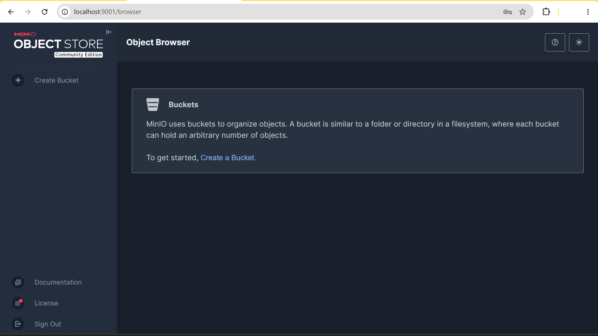
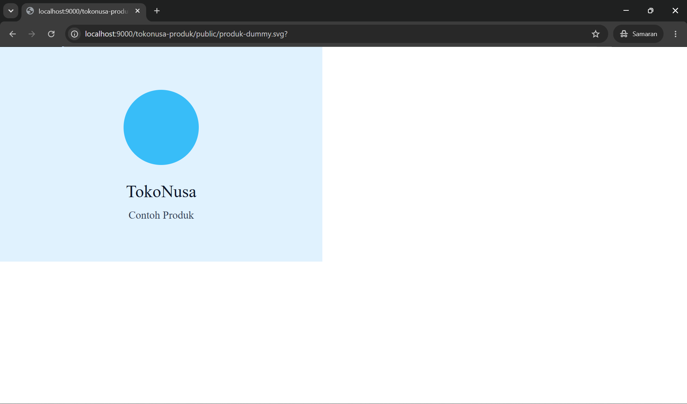

# Praktikum 2 – Model Layanan Cloud (IaaS/PaaS/SaaS)

## A. Menjalankan dan Mengonfigurasi MinIO

### 1. Tujuan Praktikum

Praktikum ini bertujuan untuk memahami penggunaan layanan Object Storage menggunakan MinIO yang kompatibel dengan antarmuka Amazon S3. MinIO digunakan sebagai simulasi penyimpanan foto produk TokoNusa.

### 2. Menjalankan Container MinIO

MinIO dijalankan menggunakan Docker Desktop melalui terminal Ubuntu (WSL2).

Perintah yang digunakan:

```bash
docker run -d --name minio-tokonusa \
  -p 9000:9000 -p 9001:9001 \
  -e MINIO_ROOT_USER=admin \
  -e MINIO_ROOT_PASSWORD=admin12345 \
  quay.io/minio/minio:latest server /data --console-address ":9001"
```

Memeriksa container:

```bash
docker ps
```

Container `minio-tokonusa` berhasil berjalan dengan status `Up`.

### 3. Mengakses MinIO Console

MinIO Console dapat diakses melalui browser Windows pada alamat:

```text
http://localhost:9001
```

Login menggunakan kredensial praktikum:

- Username: `admin`
- Password: `admin12345`

**MinIO Console**



### 4. Memasang MinIO Client (mc)

MinIO Client digunakan untuk mengelola bucket dan objek melalui terminal.

MinIO Client diunduh menggunakan perintah:

```bash
mkdir -p ~/minio-binaries

curl -fL \
  "https://github.com/minio/mc/releases/download/RELEASE.2025-08-13T08-35-41Z/mc.linux-amd64.RELEASE.2025-08-13T08-35-41Z" \
  -o ~/minio-binaries/mc
```

Memberikan izin eksekusi dan menambahkan ke PATH:

```bash
chmod +x ~/minio-binaries/mc
export PATH="$HOME/minio-binaries:$PATH"
```

Memeriksa instalasi:

```bash
mc --version
```

Versi MinIO Client yang digunakan:

```text
RELEASE.2025-08-13T08-35-41Z
```

### 5. Menghubungkan MinIO Client ke Server

Mendaftarkan server MinIO menggunakan alias `local`:

```bash
mc alias set local http://localhost:9000 admin admin12345
```

MinIO Client berhasil terhubung dengan server MinIO.

### 6. Membuat Bucket TokoNusa

Membuat bucket untuk menyimpan foto produk:

```bash
mc mb local/tokonusa-produk
```

Memeriksa bucket:

```bash
mc ls local
```

Bucket `tokonusa-produk` berhasil dibuat.

### 7. Membuat dan Mengunggah File

Membuat file contoh:

```bash
echo "contoh foto produk TokoNusa" > produk-dummy.jpg
```

Mengunggah file ke folder `public`:

```bash
mc cp produk-dummy.jpg local/tokonusa-produk/public/produk-dummy.jpg
```

Memeriksa hasil upload:

```bash
mc ls local/tokonusa-produk/public/
```

File berhasil diunggah ke bucket MinIO.

File `produk-dummy.jpg` merupakan file teks biasa sesuai instruksi tutorial. Untuk pengujian tampilan gambar di browser, dibuat file SVG tambahan bernama `produk-dummy.svg`.

### 8. Mengatur Akses Publik

Mengatur agar objek di dalam folder `public` dapat diakses tanpa login:

```bash
mc anonymous set download local/tokonusa-produk/public
```

Pengaturan akses publik berhasil diterapkan pada folder `public`.

### 9. Menguji Akses Publik

Pengujian dilakukan melalui browser Google Chrome mode Samaran (Incognito) tanpa menggunakan sesi login MinIO.

Alamat pengujian:

```text
http://localhost:9000/tokonusa-produk/public/produk-dummy.svg
```

Gambar berhasil ditampilkan tanpa meminta autentikasi. Hal ini membuktikan bahwa objek dapat diakses secara publik.

**Pengujian Akses Publik melalui Browser**



---

## B. Perluasan Worksheet Shared Responsibility Model

### 1. Object Storage (MinIO)

Pada praktikum ini, MinIO dijalankan secara mandiri menggunakan Docker Desktop dan WSL2. Berikut pembagian tanggung jawab berdasarkan lingkungan praktikum yang digunakan.

| No. | Aspek | Object Storage (MinIO) | Catatan / Justifikasi |
|---|---|---|---|
| 1 | Keamanan fisik pusat data | Pengguna | MinIO dijalankan pada laptop lokal sehingga keamanan fisik perangkat menjadi tanggung jawab pengguna. |
| 2 | Infrastruktur jaringan dasar | Pengguna | Pengguna mengelola koneksi jaringan dan konfigurasi port MinIO, yaitu 9000 dan 9001. |
| 3 | Hypervisor / virtualisasi | Pengguna | Lingkungan virtualisasi WSL2 dan Docker Desktop dikelola pada perangkat pengguna. |
| 4 | Patching sistem operasi | Pengguna | Pengguna bertanggung jawab terhadap pembaruan sistem operasi dan lingkungan WSL2. |
| 5 | Konfigurasi aplikasi/layanan | Pengguna | Pengguna menjalankan dan mengonfigurasi MinIO, termasuk membuat bucket dan mengatur akses objek. |
| 6 | Enkripsi data | Pengguna | Pengguna bertanggung jawab menentukan dan mengonfigurasi perlindungan enkripsi data pada layanan MinIO. |
| 7 | Manajemen akses (IAM) | Pengguna | Pengguna mengelola kredensial MinIO dan kebijakan akses bucket, termasuk pengaturan akses publik menggunakan `mc anonymous set download`. |
| 8 | Klasifikasi data | Pengguna | Pengguna menentukan apakah data termasuk data publik atau rahasia serta mengatur akses yang sesuai. |

**Catatan:** Pembagian tanggung jawab ini berdasarkan implementasi MinIO secara lokal menggunakan WSL2 dan Docker Desktop, bukan MinIO yang dikelola sebagai layanan oleh penyedia cloud.

### 2. Perbandingan dengan Penyimpanan Foto Produk

Terdapat perbedaan tanggung jawab antara layanan Penyimpanan Foto Produk pada worksheet Pertemuan 1 dan Object Storage (MinIO) yang dikonfigurasi secara mandiri pada Pertemuan 2. Pada implementasi MinIO lokal, pengguna bertanggung jawab lebih besar terhadap pengelolaan lingkungan, konfigurasi layanan, keamanan, dan pengaturan akses data. Hal ini terlihat ketika saya harus mengatur sendiri akses publik menggunakan perintah `mc anonymous set download`.

---

## C. Bahan Renungan

### 1. Risiko Pengaturan Akses Publik

Jika perintah `mc anonymous set download` tidak dijalankan, bucket atau folder tidak otomatis menjadi publik. Secara default, objek tetap memerlukan autentikasi sesuai kebijakan akses yang berlaku.

Apabila developer TokoNusa lupa mengatur akses untuk data yang seharusnya rahasia, risiko kebocoran dapat terjadi jika kebijakan akses publik diterapkan secara tidak tepat. Oleh karena itu, pengaturan hak akses harus disesuaikan dengan klasifikasi dan kebutuhan keamanan data.

### 2. Perbandingan MinIO dengan SaaS

Penggunaan MinIO secara mandiri membutuhkan konfigurasi dan pengelolaan lebih banyak, mulai dari menjalankan server, memasang MinIO Client, membuat bucket, mengunggah objek, hingga mengatur kebijakan akses.

Jika menggunakan layanan SaaS siap pakai, pengguna tidak perlu mengelola server, sistem operasi, instalasi aplikasi, dan pembaruan infrastruktur secara langsung. Pengguna dapat lebih berfokus pada penggunaan layanan dan pengelolaan data, meskipun konfigurasi akses dan klasifikasi data tetap menjadi tanggung jawab pengguna.

---

## D. Kesimpulan

Pada praktikum ini, MinIO berhasil dijalankan menggunakan Docker Desktop dan dikonfigurasi sebagai layanan Object Storage untuk simulasi penyimpanan foto produk TokoNusa.

Bucket `tokonusa-produk` berhasil dibuat, file contoh berhasil diunggah, dan akses publik pada folder `public` berhasil dikonfigurasi. Pengujian melalui browser Incognito membuktikan bahwa objek dapat diakses tanpa login.

Praktikum ini memberikan pemahaman mengenai penggunaan Object Storage serta pentingnya Shared Responsibility Model, khususnya dalam pengelolaan konfigurasi layanan, keamanan, dan kontrol akses data.
